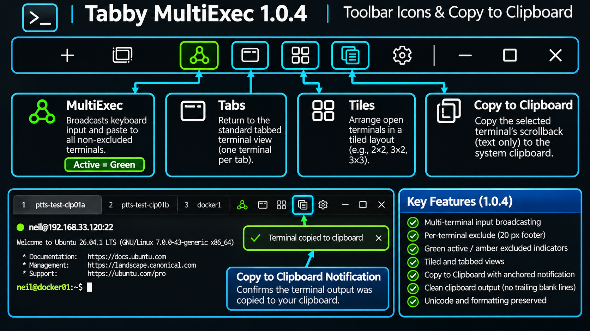
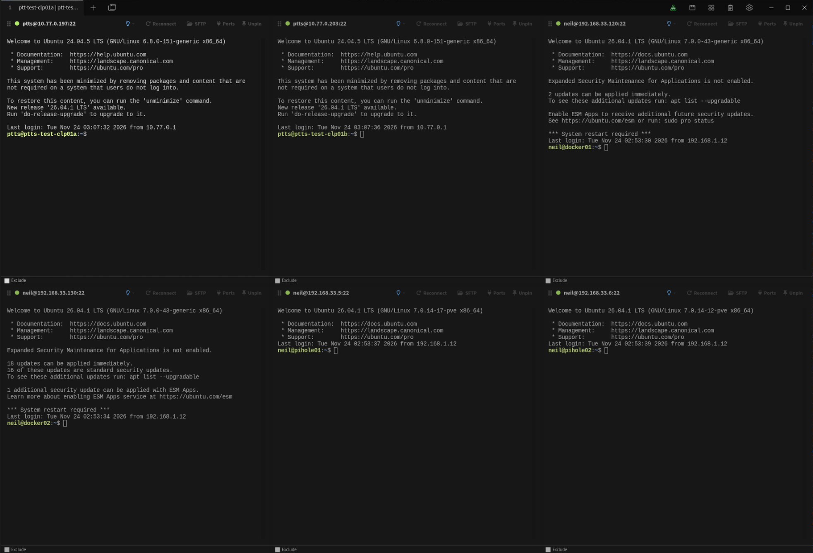
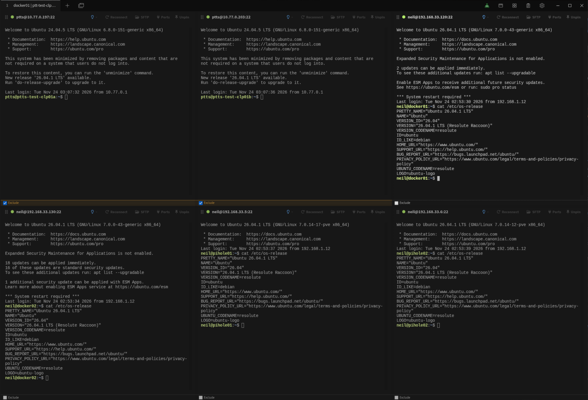
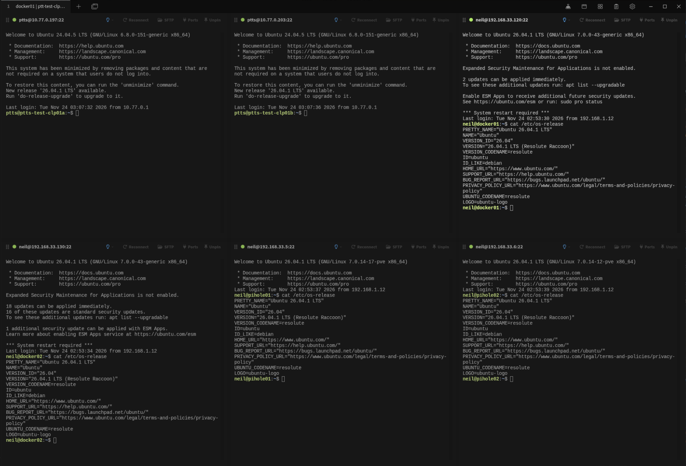

# Tabby MultiExec

**One keyboard. Multiple terminals. Complete control.**

Tabby MultiExec is a feature pack that builds on Tabby's existing MultiExec
capability and makes multi-session terminal workflows easier to manage. It adds
persistent broadcast input while switching between terminal panes, intuitive
toolbar controls, dynamic per-terminal exclusions, flexible tiled and tabbed
layouts, and one-click copying of the active terminal's complete scrollback to
the clipboard.

Version 1.0.4 introduces redesigned toolbar icons, dedicated per-terminal
Exclude controls, improved visual status indicators, enhanced paste handling,
clipboard confirmation notifications, and clean plain-text clipboard output
that preserves indentation, Unicode characters, and internal formatting.

If you work with multiple SSH sessions or local terminals and want to send the
same input across several sessions at once, Tabby MultiExec extends Tabby's
built-in MultiExec workflow with additional control, flexibility, and persistence.
Users familiar with MobaXterm's MultiExec / Multi-execution workflow will recognize
the general multi-session terminal broadcast concept, while Tabby MultiExec
remains designed specifically around Tabby's own terminal workflow.

Tabby MultiExec is an independently developed plugin. MobaXterm is a Mobatek
product referenced only to describe a comparable workflow. Tabby MultiExec is
not affiliated with, sponsored by, or endorsed by Mobatek or MobaXterm.

**Project website:** https://pttsllc.com/software/tabby-multiexec/

## Features

- Persistent MultiExec mode, even when changing the focused terminal.
- Redesigned toolbar icons: **MultiExec**, **Tabs**, **Tiles**, **Copy**.
- Green MultiExec indicator when broadcasting is enabled.
- Dedicated per-terminal **Exclude** footer controls with amber exclusion indicators.
- Exclusions can be changed while broadcasting is active.
- Automatic tiling when enabling MultiExec.
- Independent tiling and broadcasting controls.
- Restore sessions to their original tab order, with normal input confined to the selected tab.
- Single confirmation for multiline paste during MultiExec.
- One-click copying of the focused terminal's complete scrollback as plain text.
- Clipboard confirmation directly beneath the Copy icon.
- Clean clipboard output without unnecessary trailing blank lines, preserving indentation, Unicode, and internal blank lines.
- No external service or server required.

## Screenshots

### Toolbar controls and key features

Four controls provide persistent broadcasting, tab restoration, independent tiling, and complete terminal copying.

### Persistent MultiExec

Broadcast across six terminal sessions while changing the focused terminal.

### Dynamic terminal exclusion

Use the Exclude footer to remove individual terminals from broadcast input. Amber identifies excluded terminals.

### Tiled sessions without broadcast

Keep sessions tiled for visibility with MultiExec disabled.

## Installation

1. Open Tabby and navigate to **Settings → Plugins**.
2. Search for `multiexec`.
3. Install Tabby MultiExec.
4. Restart Tabby if prompted.

Existing users can update through Tabby's plugin manager. The npm package is
`tabby-multiexec`.

## Basic workflow

### MultiExec

With several terminal sessions open:

1. Click the **MultiExec** toolbar control.
2. Sessions are tiled automatically.
3. Keyboard input is broadcast to all included terminals.
4. Clicking another terminal changes the active/source terminal without
   disabling MultiExec.
5. Click MultiExec again to stop broadcasting while keeping the tiled view.

### Excluding a terminal

While MultiExec is active, each participating terminal has an **Exclude** checkbox in its footer. Excluded terminals are indicated in amber.

Checking Exclude immediately removes that terminal from broadcast output.

The checkbox can be changed dynamically while MultiExec remains active.

### Tile without MultiExec

Use the **Tiles** toolbar control to display all sessions together without
broadcasting input.

### Return to tabs

Use the **Tabs** toolbar control to return the tiled terminals to their
original tab order.

### Copy terminal

The **Copy** toolbar control copies the complete scrollback of the currently
focused terminal to the system clipboard as plain text, removing unnecessary
trailing blank rows while preserving internal formatting. A confirmation appears
beneath the Copy icon.

## Compatibility

Validated with:

- Tabby 1.0.236 and 1.0.238
- Kubuntu / Ubuntu 26.04.1 LTS with KDE Plasma
- Better Sidebar 1.0.11 tested alongside Tabby 1.0.238

Other operating systems and Tabby versions may work but have not yet been
formally validated.

## Package

npm:

https://www.npmjs.com/package/tabby-multiexec

Current release:

**1.0.4 — November 24, 2026**

Release history and patch notes:

[CHANGELOG.md](CHANGELOG.md)

## Issues and feature requests

Use the GitHub Issues section of this repository for:

- bug reports
- compatibility reports
- enhancement requests
- workflow suggestions

Please include your Tabby version and operating system when reporting a bug.

## Author

**Neil Proctor**

Developer identity: `nproctor-dev`

## Acknowledgments

Tabby MultiExec was created by Neil Proctor with development and design
assistance from ChatGPT by OpenAI.

## Source

The distributed npm package contains compiled plugin code.

The development source repository is private.

## License

Tabby MultiExec is free for personal, educational, and internal commercial use.

See `LICENSE.txt` for the complete license terms.
